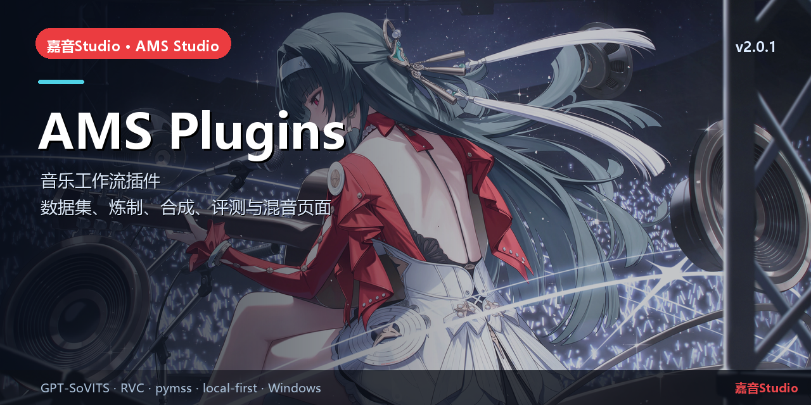

# AMS Plugins

> Cordis 音乐工作台插件 · 数据集、炼制、合成、评测、混音页面


## 简介

嘉音Studio 的 Cordis 插件 monorepo：
- `plugin-core`：Host 插件，Gateway 桥接、工具、文件/模板路由。
- `plugin-ui`：Client 插件，音乐工作台 13 个页签（项目、实时变声、音色库、音源炼制、数据集、评测、混音、分离、换源、MSVC、GSV 数据集/炼制/合成）。
- `music-bundle`：组合 bundle，负责安装两个插件。

## 核心能力

- 任务提交 + SSE 实时进度 + 产物播放/下载。
- 数据集工作室、RVC 音源炼制、歌曲换源、人声分离、混音母带、评测器。
- GPT-SoVITS TTS：数据集导入、V5turbo LoRA+GPT 炼制、48 kHz 合成。
- 旧 Piper 页签/接口已移除；只保留 GSV 链路。

## 本仓库

```text
packages/plugin-core/   Host 侧桥接与工具
packages/plugin-ui/     Client 侧音乐工作台
packages/music-bundle/  cordis.patch.yml 组合包
tools/build.mjs         构建/打包脚本
```

## 快速开始

```powershell
pnpm install
node tools/build.mjs --pack
# 安装到 Kernel profile：
dsh plugin --profile desktop add dist\*.tgz
```

## 相关链接

- 总仓库：[yan-mc/AMS-Studio](https://github.com/yan-mc/AMS-Studio)
- 最新发布：[yan-mc/ams-release releases](https://github.com/yan-mc/ams-release/releases)
- 当前版本：**嘉音Studio v2.0.1**（feed 2058）
- 文档：[ams-docs](https://github.com/yan-mc/ams-docs)

## 说明

- 所有音乐数据默认留在安装目录 `data/`；Gateway 只监听 `127.0.0.1`。
- 本项目为本地优先工具，不提供云端上传；使用第三方模型/音频时请遵守各自许可。
- License: MIT (see `LICENSE`).
